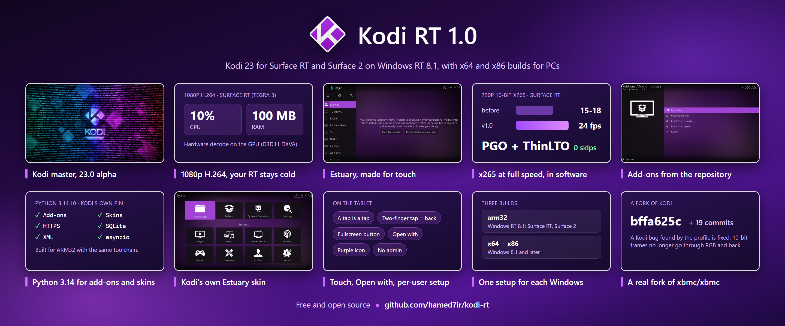

# kodi-rt

kodi for old arm windows tablets: windows rt 8.1 on the surface rt (tegra 3). this repo is a fork of kodi, and the
`kodi-rt` branch is kodi master (23.0 alpha, bffa625c) plus my commits on top. it builds for arm32 (armnt), the
point of it, and for x64 and x86 too, with python 3.14 for add-ons and skins.

kodi never had a windows build for arm32, and nothing new runs on these tablets anymore, so i ported it, the same way
as venetium. this is not an official kodi build and team kodi has nothing to do with it.

## what it runs on

- surface rt (tegra 3), windows rt 8.1: `Kodi-RT-Setup-1.0-arm32.exe`. that is the device i tested it on
- surface 2 (tegra 4) should work too, not tested on a device yet
- x64 and x86 pcs with windows 8.1 or later: `Kodi-RT-Setup-1.0-x64.exe` and `-x86.exe`. checked on my build server
  only (windows server 2022 over rdp, no gpu): the setups install and uninstall cleanly, and kodi starts, plays an
  h.264 clip in software, runs python and closes cleanly. not tried on a pc with a real gpu yet
- graphics go through direct3d 11; on the tegra 3 that is feature level 9_1

## what works

- estuary, with touch: a tap is a tap, two-finger tap is back, a tap in fullscreen video keeps the controls up, and
  estuary's touch mode is on (arm32)
- 1080p h.264 plays smooth with hardware decode on the gpu (d3d11 dxva), at about 10% cpu and 100 mb of ram, so
  your rt stays cold
- 720p 10-bit hevc (x265) plays smooth in software on the surface rt: 24 fps with no skipped frames. that needed pgo +
  thinlto, neon for ffmpeg's 10-bit motion compensation, and a fix for a kodi bug that sent every 10-bit frame through
  rgb and back
- python 3.14.10 (kodi's own pin), for add-ons and skins
- https, add-on installs from the repository, subtitles, sound through xaudio2
- "open with" in explorer: the setup lists kodi rt there for the video, music and playlist types it plays (per user,
  it doesn't take over your default apps). if kodi is already open, the file plays in that kodi (0019)
- the icon is purple, so it doesn't look like the official kodi, and the splash says 23.0 alpha (master still ships
  kodi 22's splash)

## what doesn't yet

- no ctypes in python yet (it needs libffi), and no pillow or pycryptodome, so add-ons that need them fail
- 10-bit video is shown in 8 bits on the tablet (feature level 9_1 has no 10-bit textures)
- hevc, vp9 and av1 decode in software on the tegra, it has no hardware for them. 720p x265 is what i tested
- the x64 and x86 builds have no pgo (the profile is from the tablet). their ffmpeg and dav1d do have their x86
  assembly (nasm, kodi's own pin), checked with checkasm on my build server
- pictures aren't in "open with": kodi plays a file given that way, it doesn't show pictures
- the refresh-rate fix kodi hooks into the gpu driver is left out (it needs detours and the wdk)
- it is kodi master, so expect alpha bugs

## install

download the setup for your windows from the release and run it. it installs per user (no admin) to
`%LocalAppData%\Programs\Kodi RT`, with start menu and desktop shortcuts. kodi keeps your library, add-ons and settings
in `%AppData%\Kodi` like on any windows. "check requirements" in the setup says if anything is missing.
uninstall from control panel or with `uninstall.exe`; your kodi data stays.

on the tablet skiploopfilter is 48 by default (skips the deblocking of software-decoded video, that is what makes
x265 fast enough). to change it, put your own `<skiploopfilter>` in `%AppData%\Kodi\userdata\advancedsettings.xml`:
0 is kodi's default (full quality, slower). the x64 and x86 setups keep kodi's defaults.

## how it is built

the changes to kodi are the commits on this branch (`git log bffa625c..kodi-rt`), one per change. `kodi-rt/` has
everything else: the build scripts, the toolchain files, the patches for ffmpeg (the 10-bit hevc neon) and python,
the device test kits and the installer. the full build steps are in `kodi-rt/RECIPE.md`.

everything is built with llvm-rt 2.4 (clang 23, the same toolchain line as venetium), static `/MT`. arm32 builds
against the 10.0.26100 sdk headers and the 10.0.19041 arm32 import libs (the last sdk that has them); x64 and x86 use
the 10.0.26100 sdk. the arm32 release is pgo + thinlto: kodi and ffmpeg were built with counters, i used it on the
surface rt for 16 minutes, and the release is compiled from that profile. the profile is in `kodi-rt/pgo/`.

the compiler bugs this port ran into went to llvm-rt, and they are all fixed in rt2.4.

## status

v1.0 is the first release. it works on a real device: kodi starts, touch works, video plays smooth. next: python on
its own release, ctypes, and testing on the surface 2.

## license

kodi is GPL-2.0-or-later (`LICENSE.md`). GPLv3 covers the kodi-rt changes and tooling, and ffmpeg, python and the
other upstreams keep their own licenses (see `kodi-rt/NOTICES.md`).

## credits

built on kodi (team kodi) and ffmpeg. the installer comes from venetium's. thanks to the openrt community and everyone
who tests it.

it was possible with help of claude ai.
